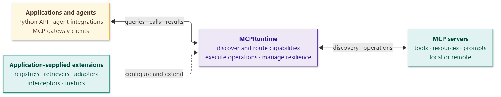

# mcp-capability-router

<p align="center">
  
</p>

<p align="center">
  <a href="https://pypi.org/project/mcp-capability-router/"></a>
  <a href="https://pypi.org/project/mcp-capability-router/"></a>
  <a href="https://github.com/smuniharish/mcp-capabilty-router/actions/workflows/ci.yml"></a>
  <a href="https://mcp-capabilty-router.readthedocs.io/en/latest/"></a>
  <a href="https://github.com/smuniharish/mcp-capabilty-router/blob/HEAD/LICENSE"></a>
</p>

**Give every agent the right MCP tools, resources, and prompts, from any number of
servers, through one resilient runtime.**

mcp-capability-router is an asyncio-first Python library that sits between your
agents and your MCP servers, whatever framework the agents use. It discovers what
each server offers, keeps that catalog current, ranks it against each request, and
runs every server operation through concurrency limits, circuit breakers, retries,
rate limits, and timeouts. An agent sees only the few tools that matter for the
current turn, however many servers and tools you register.

<picture>
  <source media="(prefers-color-scheme: dark)" srcset="https://raw.githubusercontent.com/smuniharish/mcp-capabilty-router/HEAD/docs/assets/diagrams/architecture-dark.png">
  
</picture>

## Features

- **Only the relevant tools.** Retrieval selects the capabilities that match each
  request, so models stay fast, inexpensive, and accurate with thousands of tools.
  [RetrievalLoom](https://pypi.org/project/retrievalloom/) ranks with BM25 out of the
  box, with no model and no service, fuses BM25 with any embedding model for hybrid
  ranking, and reorders the matches with an optional cross-encoder reranker.
- **Every MCP server.** Streamable HTTP, SSE, stdio, MCP configurations, and
  in-process servers through [FastMCP](https://gofastmcp.com), with lazy connections
  and automatic reconnection.
- **Always current.** Discovery runs on registration, on a schedule, on
  `list_changed` notifications, or when a query finds nothing, and writes only what
  changed, through [refresh-engine](https://refresh-engine.readthedocs.io).
- **Resilient by default.** Concurrency limits, interceptors, circuit breakers per
  server and operation, retries, rate limits, and timeouts, built on
  [purgatory](https://pypi.org/project/purgatory/),
  [tenacity](https://tenacity.readthedocs.io), and
  [aiolimiter](https://aiolimiter.readthedocs.io). Failures are classified, so a
  rejected tool call is never repeated and never opens a circuit.
- **Any agent framework.** `route_tools` returns ready-to-call tools with a name, a
  description, and a JSON schema, for the OpenAI SDK, Agno, CrewAI, or any other
  framework. The `langchain` extra adds routing middleware for `create_agent`, Deep
  Agents, and multi-agent systems, and LangChain tools for LangGraph.
- **An MCP gateway.** `as_mcp_server` serves every registered server as one MCP
  server, with tool search, a full catalog, or an experimental code mode, so any MCP
  client gets routing and resilience.
- **Isolated and observable.** One runtime per tenant shares nothing with others.
  Health states, metrics for every operation, and standard logging.
- **Typed and extensible.** Fully type-annotated ABCs for registries, retrievers,
  adapters, and interceptors, with reusable conformance tests.
- **Application-owned infrastructure.** Supply refresh StateStores, event publishers,
  fingerprints, FastMCP clients, RetrievalLoom stores, embedders, rerankers, or
  result-cache stores. Keep the index across restarts or in a Qdrant server, share
  circuits in Redis, and export
  OpenTelemetry spans, recorded by default with no duplicates.

## Installation

mcp-capability-router supports Python 3.12 through 3.14.

```bash
pip install mcp-capability-router
```

Extras add optional integrations: `langchain` for LangChain, LangGraph, and Deep
Agents, `codemode` for the gateway's code mode, `otel` for the OpenTelemetry SDK and metrics, `redis` for
Redis circuit storage, and `all` for every one of them, such as
`pip install "mcp-capability-router[langchain,otel]"`. Configure resilience with `MCPRuntime(resilience=ResiliencePolicy(...))`;
individual registrations can supply their own policy.

Router tool spans include arguments and results by default when tracing is
configured. These may contain sensitive data; set
`MCPRuntime(capture_tool_content=False)` to omit them from router spans.

## Quick start

Register a server, let the runtime discover its capabilities, and route a request to
the right tool:

<!-- test -->
```python
import asyncio

from fastmcp import FastMCP

from mcp_capability_router import MCPRuntime, RefreshPolicy

weather = FastMCP("weather")


@weather.tool
def get_forecast(city: str) -> str:
    """Get the weather forecast for a city."""
    return f"Sunny and 24 degrees in {city}"


@weather.tool
def list_alerts(region: str) -> list[str]:
    """List the active severe-weather alerts of a region."""
    return []


async def main() -> None:
    async with MCPRuntime() as runtime:
        await runtime.register_mcp("weather", weather, refresh=RefreshPolicy(on_register=True))
        [tool] = await runtime.route_tools("What is the forecast for Paris?", limit=1)
        print(tool.capability_id)

        result = await tool({"city": "Paris"})
        print(result.data)


asyncio.run(main())
```

```text
weather:tool:get_forecast
Sunny and 24 degrees in Paris
```

The server here runs in process; a URL, a script path, or an MCP configuration works
the same way.

## Route tools for an agent

`route_tools` gives any framework the tools that match a request: each has a
`name`, a `description`, and an `input_schema`, and awaiting it runs the MCP tool
through the runtime. With the `langchain` extra, add the middleware to a LangChain
agent, and every model call receives the tools that match the latest user message:

```python
from langchain.agents import create_agent

from mcp_capability_router.integrations.langchain import CapabilityRoutingMiddleware

agent = create_agent(
    "openai:gpt-5.4-mini",
    tools=[],
    middleware=[CapabilityRoutingMiddleware(runtime, limit=5)],
)
result = await agent.ainvoke(
    {"messages": [{"role": "user", "content": "What is the forecast for Paris?"}]}
)
```

To serve the router to any MCP client, such as an IDE or a desktop assistant, run
`runtime.as_mcp_server("gateway")` over Streamable HTTP. Continue with the
[getting started guide](https://mcp-capabilty-router.readthedocs.io/en/latest/getting-started/)
to add resilience, refresh policies, and observability.

## Performance

The router's overhead is small next to real MCP calls: in-process BM25 ranks 1,000
capabilities in a few milliseconds, and an operation passes through the whole
resilience pipeline in a few microseconds. See
[Performance](https://mcp-capabilty-router.readthedocs.io/en/latest/guides/performance/)
for the measurements and tuning advice.

## Downloads

<p>
  <a href="https://clickpy.clickhouse.com/dashboard/mcp-capability-router"></a>
  <a href="https://clickpy.clickhouse.com/dashboard/mcp-capability-router"></a>
  <a href="https://clickpy.clickhouse.com/dashboard/mcp-capability-router"></a>
  <a href="https://clickpy.clickhouse.com/dashboard/mcp-capability-router"></a>
</p>
<p>
  <a href="https://clickpy.clickhouse.com/dashboard/mcp-capability-router"></a>
  <a href="https://clickpy.clickhouse.com/dashboard/mcp-capability-router"></a>
  <a href="https://clickpy.clickhouse.com/dashboard/mcp-capability-router"></a>
  <a href="https://clickpy.clickhouse.com/dashboard/mcp-capability-router"></a>
  <a href="https://clickpy.clickhouse.com/dashboard/mcp-capability-router"></a>
  <a href="https://clickpy.clickhouse.com/dashboard/mcp-capability-router"></a>
  <a href="https://clickpy.clickhouse.com/dashboard/mcp-capability-router"></a>
  <a href="https://clickpy.clickhouse.com/dashboard/mcp-capability-router"></a>
  <a href="https://clickpy.clickhouse.com/dashboard/mcp-capability-router"></a>
  <a href="https://clickpy.clickhouse.com/dashboard/mcp-capability-router"></a>
  <a href="https://clickpy.clickhouse.com/dashboard/mcp-capability-router"></a>
  <a href="https://clickpy.clickhouse.com/dashboard/mcp-capability-router"></a>
  <a href="https://clickpy.clickhouse.com/dashboard/mcp-capability-router"></a>
  <a href="https://clickpy.clickhouse.com/dashboard/mcp-capability-router"></a>
  <a href="https://clickpy.clickhouse.com/dashboard/mcp-capability-router"></a>
  <a href="https://clickpy.clickhouse.com/dashboard/mcp-capability-router"></a>
  <a href="https://clickpy.clickhouse.com/dashboard/mcp-capability-router"></a>
  <a href="https://clickpy.clickhouse.com/dashboard/mcp-capability-router"></a>
  <a href="https://clickpy.clickhouse.com/dashboard/mcp-capability-router"></a>
  <a href="https://clickpy.clickhouse.com/dashboard/mcp-capability-router"></a>
  <a href="https://clickpy.clickhouse.com/dashboard/mcp-capability-router"></a>
  <a href="https://clickpy.clickhouse.com/dashboard/mcp-capability-router"></a>
</p>

Counts come from the [ClickHouse public PyPI dataset](https://clickpy.clickhouse.com/dashboard/mcp-capability-router),
which refreshes daily, so they may be about a day behind. Shields fetches the data
when a badge is requested and caches the image for up to an hour; GitHub may also
cache images. Weeks start on Monday (UTC). Explore interactive
[download charts](https://clickpy.clickhouse.com/dashboard/mcp-capability-router) on ClickPy.

## Documentation

The [documentation](https://mcp-capabilty-router.readthedocs.io/en/latest/) covers:

- [Getting started](https://mcp-capabilty-router.readthedocs.io/en/latest/getting-started/)
  and [concepts](https://mcp-capabilty-router.readthedocs.io/en/latest/concepts/)
- [Guides](https://mcp-capabilty-router.readthedocs.io/en/latest/guides/) for every
  feature, including a
  [production checklist](https://mcp-capabilty-router.readthedocs.io/en/latest/guides/production/)
- [Runnable examples](https://mcp-capabilty-router.readthedocs.io/en/latest/examples/),
  from a quick start to any framework, the MCP gateway, Deep Agents, and a durable
  capability index
- The [API reference](https://mcp-capabilty-router.readthedocs.io/en/latest/api/)
- The [architecture](https://mcp-capabilty-router.readthedocs.io/en/latest/architecture/overview/)
  and its guarantees

## Agent Skills

Coding agents such as Claude Code, Codex, Cursor, and GitHub Copilot can use the
mcp-capability-router
[Agent Skill](https://mcp-capabilty-router.readthedocs.io/en/latest/agent-skills/) to
integrate the library correctly:

```bash
npx skills add https://github.com/smuniharish/mcp-capabilty-router/tree/master/mcp-capability-router-skills/skills/mcp-capability-router
```

## Contributing

Contributions are welcome. Read the
[contributing guide](https://github.com/smuniharish/mcp-capabilty-router/blob/HEAD/CONTRIBUTING.md),
and report vulnerabilities as described in the
[security policy](https://github.com/smuniharish/mcp-capabilty-router/blob/HEAD/SECURITY.md).
Notable changes are listed in the
[changelog](https://github.com/smuniharish/mcp-capabilty-router/blob/HEAD/CHANGELOG.md).

## License

mcp-capability-router is licensed under the
[Apache License 2.0](https://github.com/smuniharish/mcp-capabilty-router/blob/HEAD/LICENSE).
